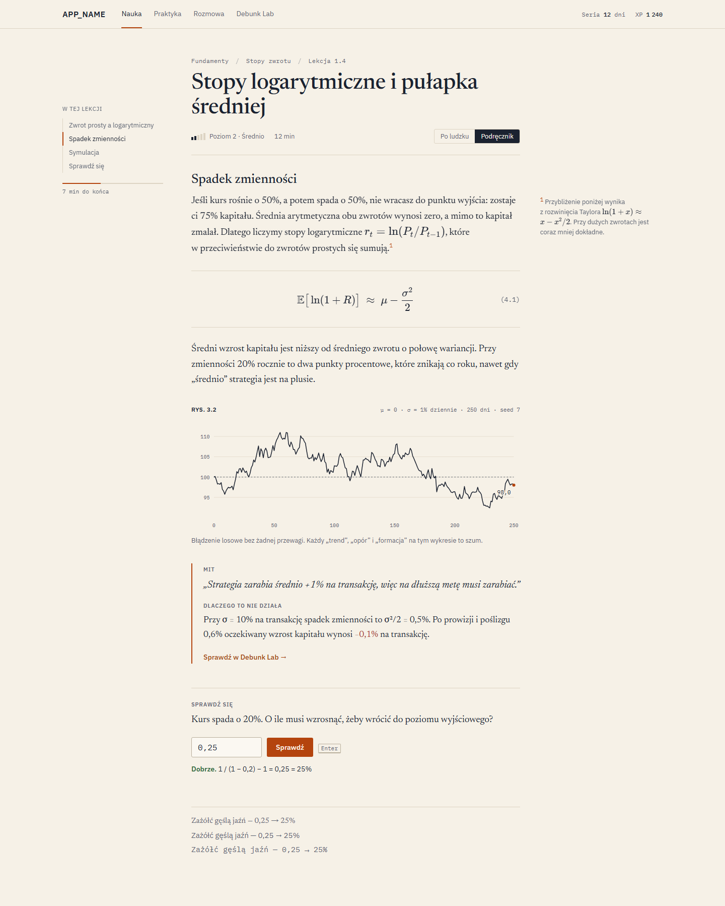

# Design

Direction **A, "research note"**, chosen on 2026-11-01 from three rendered options (exploration sources and screenshots: `design/explorations/`). The app should read like a well-typeset quant research note, with a terminal's precision for numbers. It must not look like a SaaS template.

Live reference: `/styleguide` (development and Vercel previews; returns 404 in production). Tokens: `src/styles/tokens.css`.

## Principles

1. **Paper and ink carry the interface.** Neutrals do about 90% of the work. The accent marks what you can act on and where you are.
2. **One accent: signal orange.** Use it for primary actions, links, focus, current position, the last point of a series. Never use it for decoration.
3. **Red and green are semantic.** They mean correct/wrong or a rising/falling number. They are never used for brand, sections or emphasis.
4. **Decoration is data.** Visual interest comes from real plots (a random walk, a distribution, a sparkline in a rule), not illustrations.
5. **Hairlines, not shadows.** Use 1px rules and borders to separate things. Tailwind's shadow utilities are removed from the theme.
6. **Typography does the hierarchy.** Serif for reading and headings, sans for interface, mono with tabular figures for every number that is compared or aligned.
7. **Motion is functional.** 150ms or less, no bounce, and `prefers-reduced-motion` turns it off. Gamification celebrations (Phase 14) are the only exception, and they stay restrained.

## Tokens

| Group    | Tokens                                                            | Notes                                             |
| -------- | ----------------------------------------------------------------- | ------------------------------------------------- |
| Surfaces | `--bg` `--surface` `--sunken`                                     | warm paper / deep ink blue in dark                |
| Text     | `--ink` `--ink-muted`                                             | both ≥ 4.5:1 on every surface                     |
| Lines    | `--rule` `--rule-strong` `--grid`                                 | `rule-strong` is ≥ 3:1 for control borders        |
| Accent   | `--accent` (fills) `--accent-text` (text) `--on-accent` `--focus` |                                                   |
| Semantic | `--correct` `--wrong` `--data-up` `--data-down`                   |                                                   |
| Radii    | `--r-sm` 2px, `--r` 3px, `--r-md` 4px                             | `rounded-full` only for dots and radio indicators |
| Motion   | `--duration-fast` 100ms, `--duration` 150ms, `--ease`             |                                                   |
| Layers   | `--z-sticky` `--z-dropdown` `--z-overlay` `--z-modal` `--z-toast` |                                                   |

In Tailwind they're `bg-bg`, `text-ink`, `border-rule`, `text-accent-text` and so on. The default palette, radii, shadows, blurs and animations are **removed** from the theme (`globals.css`), so `bg-purple-500`, `rounded-2xl`, `shadow-lg`, `backdrop-blur-md` and `animate-bounce` don't compile to anything. Arbitrary values that would bypass the tokens (`shadow-[…]`, `rounded-[…]`, `bg-[#…]`, `text-[13px]`) fail ESLint. `src/styles/tokens.test.ts` checks contrast for every text/background pair in both themes.

### Type

| Role                   | Face                               | Scale                                            |
| ---------------------- | ---------------------------------- | ------------------------------------------------ |
| Headings, lesson body  | Newsreader (optical sizes, italic) | `text-3xl` 44 · `text-xl` 26 · `text-reading` 19 |
| Interface              | IBM Plex Sans                      | `text-base` 15 · `text-sm` 13 · `text-xs` 12     |
| Numbers, code, tickers | IBM Plex Mono, tabular             | the `num` utility                                |

All three are self-hosted through `next/font` with the `latin-ext` subset. Playwright checks that a latin-ext face actually loads for each family. The reading column is `--measure` (68ch). Margin notes move into the right margin at the `wide` breakpoint (80rem) and sit inline below it.

## Components

- **Primitives** (`src/components/ui/`): Button, Link, Input, NumberInput, Textarea, Label, Select, Checkbox, RadioGroup, Tabs (underline and segmented), Dialog, Popover, Tooltip, Toast, Badge, Progress, Skeleton, Kbd, Table, Callout. They're built on Radix for behaviour and accessibility, with our own look. Every label is passed in by the caller, so nothing user-facing is hardcoded.
- **Signature** (`src/components/content/`): MarginNote and ReadingColumn, FigureFrame ("Rys. 3.2"), EquationBlock ("(4.1)"), StatTicker, DataRule (a hairline with an optional sparkline), WalkChart (a seeded, server-rendered chart with a separate phone layout so tick labels stay 11px).
- **NumberInput** accepts `0,25`, `0.25`, `12,5%`, `3/8` and `1e-3` through `parseLocaleNumber()` (`src/lib/math/parse-number.ts`). It rejects ambiguous input like `1.234,5` rather than guessing. The Phase 9 grader uses the same function.

## Do

- A lesson reads as a typeset note: a serif column, numbered equations and figures, notes in the margin.
- Numbers are mono and tabular. Polish formatting everywhere (`0,25`, `1 240`).
- The chart is the illustration. Its parameters (μ, σ, seed) are printed next to it.
- The myth callout uses a left rule and the content does the arguing. Red appears only on the number that is actually negative.

Style guide in both themes: `design/styleguide-light-desktop.png`, `design/styleguide-dark-desktop.png` (plus `-mobile` versions). Refresh them with `CAPTURE=1 pnpm test:e2e e2e/styleguide.spec.ts`.

## Don't

The **banned list** (from CLAUDE.md), all of which the counter-example above contains:

- purple/blue gradients, glowing blobs, gradient text
- glassmorphism (`backdrop-filter: blur` panels)
- emoji in the UI; sparkle, rocket, gem and brain icons
- "Unlock your potential" copy, "revolutionary platform", promises of profit
- a generic hero with three icon cards
- everything `rounded-2xl` with drop shadows
- default Inter
- lorem ipsum, fake testimonials, fake user counts and star ratings
- stock 3D illustrations

On top of the list, for this product: no copy that implies trading profits, and no "Pro Strategies". We teach why most strategies fail.

## Review checklist (run on every UI change)

1. Only token colours. Red/green only for correctness or data direction.
2. No shadows and no radius above 4px (except dots).
3. Every number that is compared or aligned uses mono/tabular. Polish number format.
4. Focus is visible, every control has a label, axe passes in both themes.
5. Works at 360px: long equations scroll inside their block, never the page.
6. No item from the banned list. Copy is calm, precise and mentor-like, with no hype.
